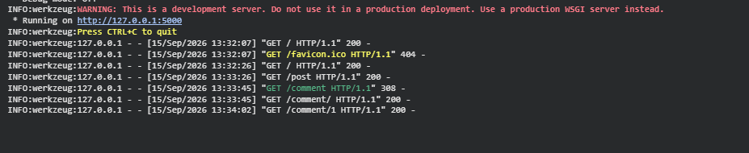
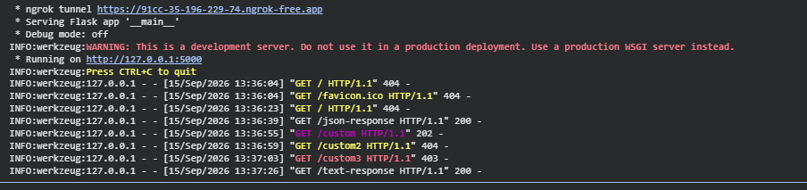

## Como Testar se as Rotas Estão Funcionando

Após iniciar o servidor (0.0.0.0:8000), abra o navegador ou um cliente de API (como Insomnia, Postman ou curl) e acesse os seguintes caminhos:

- Healthcheck: http://localhost:8000/healthz
- Listar Posts: http://localhost:8000/posts
- Buscar Post por ID: http://localhost:8000/posts/101
- Listar Comentários: http://localhost:8000/comments
- Listar Usuários: http://localhost:8000/users
- Posts de um Usuário: http://localhost:8000/users/victor/posts


Rodando no Google Colab e NGrok:






### Assuntos e Ferramentas utilizadas

* **Application Factory Pattern (`create_app`):** Evita variáveis globais soltas e facilita testes automatizados e múltiplas instâncias da aplicação.
* **Blueprints (Modularização):** Separa as rotas por domínio de negócio (`posts`, `comments`, `users`, `health`).
* **Injeção de Dependência e Camada de Serviços (Service Pattern):** A lógica de negócios fica isolada das rotas HTTP.
* **Tratamento Global de Erros e Schemas DTO:** Respostas padronizadas em JSON com códigos HTTP adequados (RESTful) e Type Hints (PEP 484).
* **Logs Estruturados e Observabilidade:** Configuração nativa de logging para monitoramento e tracing de requisições.

---

### Estrutura do Projeto Modular

```text
src/
├── app.py                  # Ponto de entrada (Application Factory)
├── services/               # Lógica de negócios e comunicação com BD/APIs
│   ├── post_service.py
│   ├── comment_service.py
│   └── user_service.py
└── routes/                 # Handlers HTTP / Blueprints
    ├── health.py
    ├── posts.py
    ├── comments.py
    └── users.py

```

---

### 1. Camada de Serviços (`src/services/`)

Definimos as regras de negócio simulando dados reais estruturados:

```python
# src/services/post_service.py
from typing import Dict, List, Optional

class PostService:
    def __init__(self) -> None:
        # Simulação de repositório/banco de dados
        self._posts: List[Dict[str, str | int]] = [
            {"id": 101, "title": "Arquitetura Escalável em Flask", "author": "victor"},
            {"id": 102, "title": "MLOps na Prática com Docker", "author": "victor"}
        ]

    def list_all(self) -> List[Dict[str, str | int]]:
        return self._posts

    def get_by_id(self, post_id: int) -> Optional[Dict[str, str | int]]:
        return next((post for post in self._posts if post["id"] == post_id), None)

    def get_by_author(self, username: str) -> List[Dict[str, str | int]]:
        return [post for post in self._posts if post["author"].lower() == username.lower()]

```

```python
# src/services/comment_service.py
from typing import Dict, List, Optional

class CommentService:
    def __init__(self) -> None:
        self._comments: List[Dict[str, str | int]] = [
            {"id": "c1001", "post_id": 101, "content": "Excelente estrutura de código!"},
            {"id": "c1002", "post_id": 101, "content": "Muito bom o padrão com Blueprints."}
        ]

    def list_all(self) -> List[Dict[str, str | int]]:
        return self._comments

    def get_by_id(self, comment_id: str) -> Optional[Dict[str, str | int]]:
        return next((comment for comment in self._comments if comment["id"] == comment_id), None)

```

---

### 2. Camada de Módulos / Blueprints (`src/routes/`)

#### Rotas de Monitoramento (`src/routes/health.py`)

```python
from flask import Blueprint, jsonify, Response

health_bp = Blueprint("health", __name__)

@health_bp.route("/healthz", methods=["GET"])
def health_check() -> tuple[Response, int]:
    """Endpoint de verificação de integridade (Liveness Probe para Kubernetes)."""
    return jsonify({"status": "UP", "service": "social-api"}), 200

```

#### Rotas de Posts (`src/routes/posts.py`)

```python
from flask import Blueprint, jsonify, Response
from src.services.post_service import PostService

posts_bp = Blueprint("posts", __name__, url_prefix="/posts")
post_service = PostService()

@posts_bp.route("", methods=["GET"])
def get_posts() -> tuple[Response, int]:
    posts = post_service.list_all()
    return jsonify({"data": posts, "count": len(posts)}), 200

@posts_bp.route("/<int:post_id>", methods=["GET"])
def get_post_detail(post_id: int) -> tuple[Response, int]:
    post = post_service.get_by_id(post_id)
    if not post:
        return jsonify({"error": "NOT_FOUND", "message": f"Post {post_id} não encontrado."}), 404
    return jsonify({"data": post}), 200

```

#### Rotas de Comentários (`src/routes/comments.py`)

```python
from flask import Blueprint, jsonify, Response
from src.services.comment_service import CommentService

comments_bp = Blueprint("comments", __name__, url_prefix="/comments")
comment_service = CommentService()

@comments_bp.route("", methods=["GET"])
def get_comments() -> tuple[Response, int]:
    comments = comment_service.list_all()
    return jsonify({"data": comments, "count": len(comments)}), 200

@comments_bp.route("/<string:comment_id>", methods=["GET"])
def get_comment_detail(comment_id: str) -> tuple[Response, int]:
    comment = comment_service.get_by_id(comment_id)
    if not comment:
        return jsonify({"error": "NOT_FOUND", "message": f"Comentário {comment_id} não encontrado."}), 404
    return jsonify({"data": comment}), 200

```

#### Rotas de Usuários (`src/routes/users.py`)

```python
from flask import Blueprint, jsonify, Response
from src.services.post_service import PostService

users_bp = Blueprint("users", __name__, url_prefix="/users")
post_service = PostService()

@users_bp.route("/<string:username>/posts", methods=["GET"])
def get_user_posts(username: str) -> tuple[Response, int]:
    posts = post_service.get_by_author(username)
    return jsonify({"username": username, "data": posts, "count": len(posts)}), 200

```

---

### 3. Application Factory & Configuração Principal (`src/app.py`)

Centraliza o ciclo de vida do servidor, registro de rotas e manipuladores globais de erro:

```python
import logging
from flask import Flask, jsonify, Response

from src.routes.health import health_bp
from src.routes.posts import posts_bp
from src.routes.comments import comments_bp
from src.routes.users import users_bp

def create_app() -> Flask:
    app = Flask(__name__)
    
    # Configuração de Logs Estruturados
    logging.basicConfig(
        level=logging.INFO,
        format="%(asctime)s [%(levelname)s] %(name)s: %(message)s"
    )

    # Registro de Blueprints
    app.register_blueprint(health_bp)
    app.register_blueprint(posts_bp)
    app.register_blueprint(comments_bp)
    app.register_blueprint(users_bp)

    # Handler Global de Erro 404 (JSON RESTful)
    @app.errorhandler(404)
    def handle_not_found(error) -> tuple[Response, int]:
        return jsonify({
            "error": "RESOURCE_NOT_FOUND",
            "message": "A URL/Recurso solicitado não foi localizado nesta API."
        }), 404

    # Handler Global de Erro 500
    @app.errorhandler(Exception)
    def handle_internal_error(error) -> tuple[Response, int]:
        app.logger.error(f"Unhandled Exception: {str(error)}", exc_info=True)
        return jsonify({
            "error": "INTERNAL_SERVER_ERROR",
            "message": "Ocorreu um erro interno no servidor."
        }), 500

    return app

if __name__ == "__main__":
    app = create_app()
    app.run(host="0.0.0.0", port=8000, debug=True)

```

---

### Mapeamento de Mudanças em Relação ao Código Original

| Item Original | Problema de Arquitetura | Padrão Profissional / Refatorado |
| --- | --- | --- |
| `return "OK!"` | Resposta em texto puro em API | Resposta em `JSON` com contrato bem definido (`{"data": ...}`). |
| Rotas globais na raiz | Dificuldade de manutenção | Uso de **Blueprints** com `url_prefix` (`/posts`, `/comments`). |
| `/post` vs `/post/<id>` | Inconsistência de plural no REST | Pluralização de recursos no padrão REST (`/posts` e `/posts/<id>`). |
| Sem tratamento de erro | Retornava páginas HTML 404 padrão do Flask | Handlers globais de erro que garantem respostas sempre em JSON. |
| Inexistência de camadas | Lógica misturada no arquivo principal | Separação clara entre **Controladores/Rotas** e **Camada de Serviços**. |